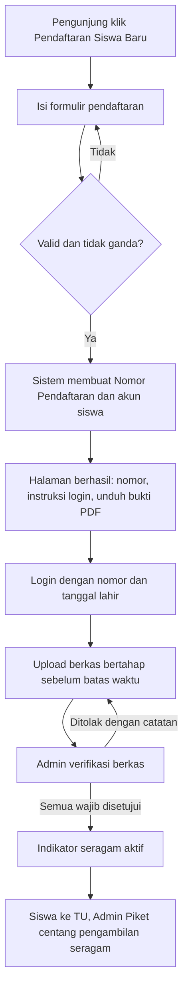
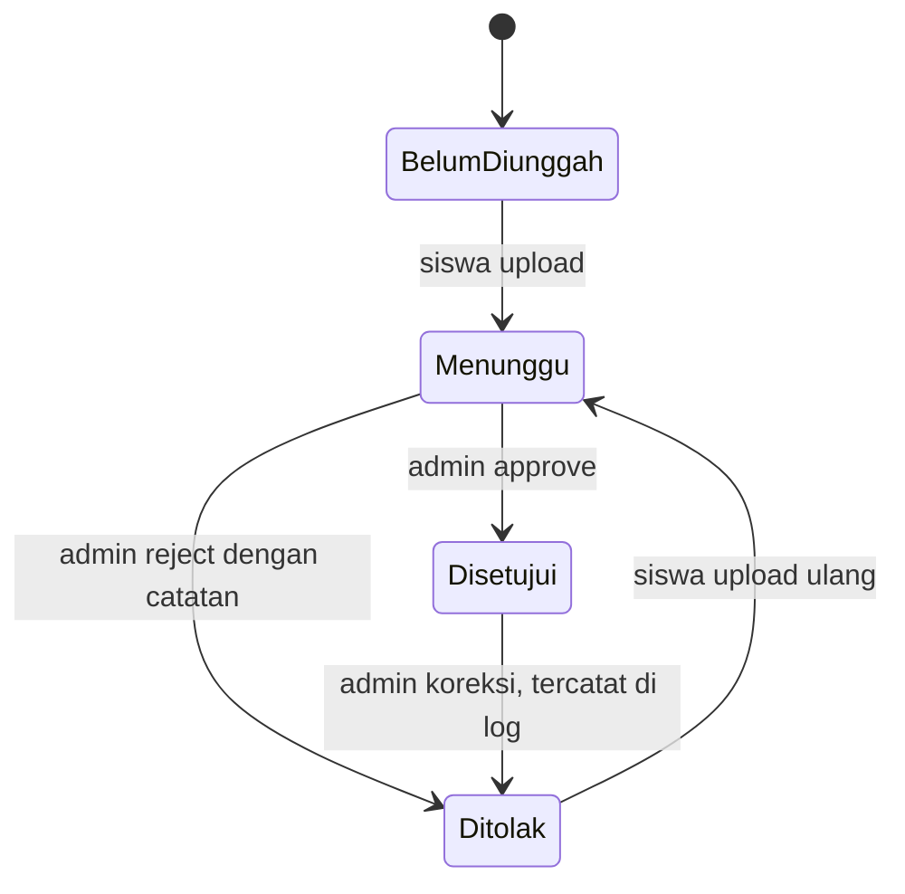

# PRD — Sistem Web Company Profile dan PPDB Sekolah

| | |
|---|---|
| **Sumber kebenaran** | SRS Sistem Web Company Profile dan PPDB v1.0 (ID kebutuhan `FR-xx`, `BR-xx`, `NFR-xx` mengacu ke dokumen itu) |
| **Pembaca utama** | AI coding agent yang membangun sistem |
| **Teknologi** | Laravel, MySQL, dikembangkan di Laragon |
| **Fokus dokumen** | Alur dan fitur. Tampilan, tata letak, dan gaya visual ada di file design `.md` terpisah (di dokumen ini disebut `DESIGN.md`; sesuaikan dengan nama file sebenarnya) |
| **Bahasa antarmuka** | Bahasa Indonesia |

Jika PRD ini bertentangan dengan SRS, **SRS yang menang**, kecuali bagian yang ditandai **(default)**. Itu adalah keputusan teknis yang SRS belum tetapkan dan boleh diubah jika mitra meminta lain.

---

## 1. Ringkasan Produk

Satu aplikasi web untuk sebuah sekolah yang berisi empat modul pada satu basis data:

1. **Halaman Publik (Company Profile)**: informasi sekolah, berita, pengumuman, prestasi, galeri, info PPDB, kontak.
2. **Portal Calon Siswa**: registrasi mandiri, login, upload berkas bertahap dengan batas waktu, pantau status verifikasi.
3. **Area Admin Piket**: pendaftaran offline, verifikasi berkas, loket seragam, kelola berita dan prestasi.
4. **Area Super Admin**: semua fitur Admin Piket ditambah konfigurasi, ekspor, unlock, akun staf, statistik, log, dan kelola seluruh konten publik.

Tujuan: sekolah dapat menerima pendaftar baru secara daring maupun langsung, memverifikasi berkas secara digital, dan mengendalikan hak pengambilan seragam, sambil memiliki website profil yang mudah diperbarui oleh staf.

---

## 2. Cara Menggunakan Dokumen Ini (untuk Agent)

- Kerjakan berurutan sesuai **Bagian 11 (Tahapan Pembangunan)**. Setiap fitur dianggap selesai jika **kriteria selesai**-nya terpenuhi dan punya feature test.
- Jangan menambah fitur di luar **Bagian 10 (Di Luar Cakupan)**.
- Untuk hal yang belum diputuskan (**Bagian 12**), pakai nilai default yang tertulis, lalu catat asumsinya di `docs/ASUMSI.md`.
- Satu area `/admin` dengan **menu yang difilter per peran**, bukan dua aplikasi terpisah. Super Admin otomatis memiliki semua menu Admin Piket (FR-15).
- Semua keputusan visual mengikuti `DESIGN.md`. PRD ini tidak menentukan layout.

---

## 3. Teknologi dan Lingkungan

### 3.1 Stack

| Lapisan | Pilihan |
|---|---|
| Framework | Laravel (versi stabil terbaru yang kompatibel dengan PHP bawaan Laragon pengguna) |
| Basis data | MySQL (InnoDB, `utf8mb4`), dikelola lewat **migration** dan **seeder** |
| View | Blade. Gaya mengikuti `DESIGN.md` |
| Autentikasi | Session auth Laravel dengan **dua guard terpisah**: `siswa` (calon siswa) dan `web` (staf) |
| Otorisasi | Middleware peran + Policy/Gate |
| Pengujian | Pest atau PHPUnit (feature test per alur) |

Paket pendukung yang **disarankan** (boleh diganti yang setara):

| Kebutuhan | Paket |
|---|---|
| Bukti pendaftaran PDF (FR-22) dan ekspor PDF | `barryvdh/laravel-dompdf` |
| Ekspor Excel/CSV (FR-16) | `maatwebsite/excel` |
| Sanitasi HTML isi berita/prestasi (NFR-05) | `mews/purifier` atau `stevebauman/purify` |
| Editor teks kaya untuk isi berita | Trix, Quill, atau TinyMCE (sesuai `DESIGN.md`) |

### 3.2 Lingkungan Lokal (Laragon)

- Proyek ditempatkan di `C:\laragon\www\<nama-proyek>` sehingga otomatis tersedia sebagai `http://<nama-proyek>.test`.
- Konfigurasi `.env` awal untuk MySQL Laragon:

```env
DB_CONNECTION=mysql
DB_HOST=127.0.0.1
DB_PORT=3306
DB_DATABASE=ppdb_sekolah
DB_USERNAME=root
DB_PASSWORD=
APP_TIMEZONE=Asia/Jakarta
APP_LOCALE=id
SESSION_LIFETIME=30
```

- Pastikan ekstensi PHP `fileinfo` dan `gd` aktif (validasi MIME upload dan gambar).
- Jalankan `php artisan storage:link` untuk disk publik. Disk **privat** dipakai khusus untuk berkas siswa.
- Produksi wajib HTTPS (NFR-04). Itu urusan deployment, bukan kode, tetapi `APP_URL` dan *force HTTPS* harus disiapkan.

### 3.3 Seeder Wajib

- 1 akun **Super Admin** awal (kredensial dari `.env`, dan wajib diganti setelah login pertama).
- 1 **tahun ajaran** aktif dan **pengaturan sistem** awal (batas waktu, ukuran maksimal file 2 MB).
- Master **jenis berkas**: Kartu Keluarga (wajib), Akta Kelahiran (wajib), Ijazah/SKL (wajib). Daftar final dari mitra. Tidak ada UI untuk mengubahnya di v1.
- Konten contoh secukupnya agar halaman publik tidak kosong saat demo.

---

## 4. Peran dan Hak Akses

| Fitur | Pengunjung | Calon Siswa | Admin Piket | Super Admin |
|---|:-:|:-:|:-:|:-:|
| Lihat halaman publik | ✔ | ✔ | ✔ | ✔ |
| Registrasi mandiri | ✔ | | | |
| Login, upload berkas, lihat status **sendiri** | | ✔ | | |
| Pendaftaran offline | | | ✔ | ✔ |
| Cari dan lihat data calon siswa | | | ✔ | ✔ |
| Verifikasi berkas (Approve/Reject) | | | ✔ | ✔ |
| Loket seragam | | | ✔ | ✔ |
| **Kelola berita dan prestasi (tambah, lihat, ubah, hapus)** | | | ✔ | ✔ |
| Kelola konten publik lainnya (informasi sekolah, fasilitas, ekskul, pengumuman, galeri) | | | | ✔ |
| Ekspor data | | | | ✔ |
| Unlock akses upload | | | | ✔ |
| Atur batas waktu dan kelola akun Admin Piket | | | | ✔ |
| Koreksi data siswa | | | | ✔ |
| Statistik dan log aktivitas | | | | ✔ |

Aturan implementasi:

- Akun staf punya `role` (`super_admin` / `admin_piket`) dan status aktif. Akun nonaktif tidak bisa login.
- Admin Piket yang membuka menu khusus Super Admin menerima **403**.
- Rute siswa **tidak boleh menerima ID siswa dari URL**. Selalu pakai siswa yang sedang login, agar siswa tidak bisa melihat data siswa lain (BR-09).

---

## 5. Peta Halaman (Rute Tingkat Tinggi)

| Area | Rute | Keterangan |
|---|---|---|
| Publik | `/`, `/visi-misi`, `/fasilitas`, `/ekstrakurikuler` | Informasi sekolah |
| Publik | `/berita`, `/berita/{slug}` | Daftar dan detail |
| Publik | `/pengumuman`, `/prestasi`, `/prestasi/{slug}`, `/galeri` | |
| Publik | `/ppdb` | Alur, persyaratan, jadwal, tombol daftar |
| Publik | `/kontak` | Alamat, telepon, email, lokasi |
| PPDB | `/ppdb/daftar`, `/ppdb/berhasil` | Formulir fase 1 dan halaman sukses |
| Siswa | `/siswa/login`, `/siswa/dashboard`, `/siswa/berkas`, `/siswa/bukti` | Butuh guard `siswa` |
| Admin | `/admin/login`, `/admin` | Dashboard sesuai peran |
| Admin | `/admin/pendaftar`, `/admin/pendaftar/baru`, `/admin/pendaftar/{id}` | Daftar, offline, detail + verifikasi |
| Admin | `/admin/seragam` | Loket seragam |
| Admin | `/admin/berita`, `/admin/prestasi` | CRUD, **Admin Piket dan Super Admin** |
| Super Admin | `/admin/konten/*`, `/admin/ekspor`, `/admin/pengaturan`, `/admin/staf`, `/admin/log`, `/admin/tahun-ajaran` | Hanya Super Admin |

Catatan: **Nomor Pendaftaran mengandung karakter `/`** (mis. `PPDB/2026/0001`). Jangan pakai nomor ini di URL. Pakai ID internal atau token.

---

## 6. Fitur per Modul

Format: **ID SRS · Prioritas**, lalu *perilaku* dan *kriteria selesai*.

### 6.1 Modul A. Halaman Publik

**FR-01 Informasi Sekolah · Tinggi**
- Perilaku: Beranda, Visi Misi, Fasilitas, Ekstrakurikuler tampil dari konten yang dikelola Super Admin (FR-28), bukan hardcode.
- Selesai jika: mengubah konten lewat admin langsung tampil di halaman publik.

**FR-02 Berita, Pengumuman, Prestasi, Galeri · Tinggi**
- Perilaku: Berita dan Prestasi punya halaman **daftar** (paginasi) dan **detail**. Pengumuman dan Galeri tampil sebagai daftar. **Hanya konten berstatus Terbit** yang tampil (BR-11). Urut dari terbaru.
- Selesai jika: konten Draf tidak muncul di daftar, detail, maupun akses langsung via URL (404).

**FR-03 Call-to-Action PPDB · Tinggi**
- Perilaku: tombol "Pendaftaran Siswa Baru" tampil jelas (terutama di Beranda) dan mengarah ke `/ppdb/daftar`.

**FR-19 Informasi Alur PPDB · Tinggi**
- Perilaku: halaman `/ppdb` menampilkan alur, persyaratan dokumen, dan jadwal. **Daftar persyaratan diambil dari master jenis berkas** agar tidak berbeda dengan yang diminta sistem. Teks alur dan jadwal dikelola Super Admin.

**FR-20 Kontak dan Lokasi · Sedang**
- Perilaku: alamat, telepon, email, dan lokasi sekolah (peta tersemat atau tautan peta).

### 6.2 Modul B. Portal Calon Siswa

**FR-04 Registrasi (Fase 1) · Tinggi**
- Perilaku: formulir data diri → sistem membuat **Nomor Pendaftaran** otomatis dan akun siswa. Setelah sukses **tidak ada auto-login**. Kolom awal: nama lengkap, NIK, NISN, tempat dan tanggal lahir, jenis kelamin, alamat, asal sekolah, nama orang tua/wali, nomor HP orang tua/wali. Daftar final dari mitra.
- Pembuatan nomor: format **(default)** `PPDB/{tahun}/{urut 4 digit}`, urut per tahun ajaran. Buat di dalam **transaksi dengan row lock** agar tidak ganda saat banyak yang mendaftar bersamaan. Nomor `unique` dan tidak bisa diubah (BR-01).
- Selesai jika: dua pendaftaran serentak tidak pernah menghasilkan nomor sama.

**FR-05 Instruksi Login (Fase 1) · Tinggi**
- Perilaku: halaman `/ppdb/berhasil` menampilkan Nomor Pendaftaran, instruksi login (username = nomor, password = tanggal lahir), dan tombol unduh bukti. **Nilai password tidak dicetak**, hanya instruksinya.

**FR-21 Validasi Data Pendaftaran · Tinggi**
- Perilaku: validasi kelengkapan dan format. **(default)** NIK 16 digit, NISN 10 digit, tanggal lahir valid dan tidak di masa depan, nomor HP format Indonesia. Tolak pendaftaran ganda berdasarkan **NIK atau NISN yang sama dalam tahun ajaran yang sama**, dengan pesan jelas. Tegakkan juga dengan unique index di database.

**FR-22 Bukti Pendaftaran PDF · Sedang**
- Perilaku: PDF berisi Nomor Pendaftaran, nama, dan instruksi login. Dapat diunduh siswa (halaman sukses dan dashboard) dan oleh Admin Piket (untuk pendaftaran offline).

**FR-06 Autentikasi Siswa (Fase 2) · Tinggi**
- Perilaku: login dengan Nomor Pendaftaran + Tanggal Lahir. Password disimpan **hash** (BR-02). Tanggal lahir dinormalisasi ke `DDMMYYYY` sebelum dicek. Ada logout. Pesan gagal login tidak membocorkan apakah nomornya ada.
- Pembatasan: **5 kali gagal beruntun → kunci sementara 5 menit (default)** per nomor + IP (NFR-08). Sesi habis setelah 30 menit tidak aktif (NFR-06).

**FR-23 Dashboard Calon Siswa · Tinggi**
- Perilaku: ringkasan data diri, daftar berkas beserta statusnya, catatan penolakan, progres, timer (FR-08), dan indikator seragam (FR-09).

**FR-07 Upload Berkas Bertahap · Tinggi**
- Perilaku: siswa mengunggah tiap jenis berkas kapan saja selama masih dibuka. Boleh dicicil di banyak kali akses. Satu berkas aktif per jenis. Upload baru **mengganti** berkas lama dan file lama dihapus dari penyimpanan.
- Aturan boleh/tidak upload: boleh jika status **Belum Diunggah** atau **Ditolak**. Tidak boleh jika **Menunggu** atau **Disetujui** **(default)**.
- Penyimpanan: disk **privat**, nama file diacak, folder per siswa. Berkas dibuka lewat rute yang mengecek hak akses (NFR-07). Hanya pemilik berkas dan staf yang boleh melihat.

**FR-24 Validasi File Upload · Tinggi**
- Perilaku: format PDF/JPG/JPEG/PNG dan maksimal 2 MB per file. Cek **MIME sebenarnya**, bukan hanya ekstensi. Pesan kesalahan jelas per kasus (format salah, terlalu besar).

**FR-25 Upload Ulang Berkas Ditolak · Tinggi**
- Perilaku: siswa mengganti berkas berstatus Ditolak → status kembali **Menunggu**. Catatan penolakan lama tetap terlihat sampai diverifikasi ulang.

**FR-08 Indikator dan Timer · Tinggi**
- Perilaku: progres (mis. jumlah berkas wajib yang sudah diunggah dari total), status tiap berkas, dan **hitung mundur ke batas waktu**. Server mengirim waktu server dan tenggat. Browser hanya menampilkan hitungan, dan **server tetap memvalidasi setiap upload** (BR-07).

**FR-09 Clearance Seragam · Tinggi**
- Perilaku: indikator "berhak mengambil seragam ke TU" tampil **hanya jika semua berkas wajib Disetujui** (BR-05). Dihitung dari data, tidak disimpan sebagai flag yang bisa basi.

**FR-10 Lockdown · Tinggi**
- Perilaku: jika waktu server melewati batas waktu dan siswa belum di-unlock, fitur upload nonaktif **di sisi server** (tombol dinonaktifkan dan request ditolak) dan tampil peringatan agar melapor ke Super Admin (BR-08). Lockdown dihitung dari perbandingan waktu, **tidak butuh cron**.

### 6.3 Modul C. Admin Piket

**FR-11 Pendaftaran Offline · Tinggi**
- Perilaku: formulir sama dengan FR-04 yang diisi petugas. Nomor dibuat dengan aturan sama. Penanda jalur = `offline`. Akun siswa tetap dibuat agar bisa login nanti. Setelah simpan, petugas dapat mencetak bukti (FR-22).

**FR-12 Tracking Data · Tinggi**
- Perilaku: cari berdasarkan Nomor Pendaftaran atau Nama (pencarian parsial).

**FR-26 Daftar dan Filter Siswa · Sedang**
- Perilaku: daftar dengan paginasi dan filter status berkas serta status seragam. **Status berkas ringkas per siswa (default)**, urutan prioritas: *Ada yang Ditolak* → *Menunggu Verifikasi* → *Belum Lengkap* → *Disetujui Semua*.

**FR-13 Verifikasi Berkas · Tinggi**
- Perilaku: staf membuka dokumen (pratinjau lewat rute berotorisasi), lalu **Approve** atau **Reject**. **Reject wajib disertai catatan** (BR-04). Sistem menyimpan siapa yang memverifikasi dan kapan. Catatan terlihat oleh siswa.
- Status Disetujui bisa diubah staf (mis. jadi Ditolak dengan catatan) dan perubahan itu **wajib masuk log** (BR-10).

**FR-14 Loket Seragam · Tinggi**
- Perilaku: checklist pengambilan seragam. Tombol **terkunci** kecuali semua berkas wajib siswa berstatus Disetujui. Penguncian juga **dicek di server**, bukan hanya di tampilan.

**FR-27 Pencatatan Seragam · Tinggi**
- Perilaku: simpan petugas dan waktu pengambilan. **Hanya boleh sekali per siswa** (BR-06), dijaga dengan unique constraint dan transaksi agar klik ganda atau dua petugas tidak menghasilkan dua catatan.

**Kelola Berita dan Prestasi (FR-37 s.d. FR-42, lihat 6.5)** juga tersedia untuk Admin Piket.

### 6.4 Modul D. Super Admin

**FR-15 Akses Penuh · Tinggi**: semua fitur Admin Piket.

**FR-16 Ekspor Data · Tinggi**
- Perilaku: unduh data calon siswa dalam Excel, CSV, dan PDF. Isi: data diri, ringkasan status berkas, dan status seragam. **(default)** untuk tahun ajaran aktif. Hanya Super Admin (NFR-09, data hanya untuk keperluan PPDB).

**FR-17 Bypass Status (Unlock) · Tinggi**
- Perilaku: Super Admin membuka kembali upload untuk **siswa tertentu** setelah lockdown. **(default)** unlock berupa penanda per siswa tanpa tenggat baru. Aksi **tercatat di log**.

**FR-18 Konfigurasi · Tinggi**
- Perilaku: atur batas waktu kelengkapan berkas (berlaku untuk semua siswa, BR-07) dan kelola akun Admin Piket (tambah, ubah, nonaktifkan).

**FR-28 Manajemen Konten Publik · Tinggi**
- Perilaku: tambah, ubah, hapus konten **selain berita dan prestasi**: informasi sekolah, fasilitas, ekstrakurikuler, pengumuman, galeri. Hanya Super Admin.

**FR-29 Koreksi Data Siswa · Sedang**
- Perilaku: Super Admin mengoreksi data siswa, termasuk tanggal lahir. **Jika tanggal lahir berubah, password otomatis di-hash ulang dari tanggal lahir baru.** Aksi tercatat di log.

**FR-30 Dashboard Statistik · Sedang**
- Perilaku: jumlah pendaftar (online/offline), rekap status berkas (per status), dan jumlah pengambilan seragam.

**FR-31 Log Aktivitas · Sedang**
- Perilaku: daftar log dengan pelaku, jenis aksi, objek, waktu, dan IP. **Minimal** mencatat: login staf (berhasil dan gagal), verifikasi berkas, unlock, perubahan konfigurasi, koreksi data, tambah/ubah/hapus berita dan prestasi, serta pencatatan seragam. Login siswa tidak dicatat **(default)**.

**FR-32 Manajemen Tahun Ajaran · Rendah**
- Perilaku: kelola periode PPDB agar data tiap periode terpisah dan bisa diarsipkan.
- **Siapkan sejak awal**: semua data pendaftar membawa `tahun_ajaran_id` dan query default memakai tahun ajaran aktif, supaya fitur ini nanti tidak membutuhkan refactor.

### 6.5 Modul E. Manajemen Berita dan Prestasi (Admin Piket dan Super Admin)

Fitur baru dari revisi SRS. **Kedua peran punya hak penuh yang sama atas seluruh data, tanpa melihat siapa pembuat awalnya** (BR-12).

**FR-37 Tambah (Create) · Tinggi**
- Berita: judul, isi (teks kaya), gambar sampul, tanggal terbit, status.
- Prestasi: nama prestasi, nama peraih (siswa, tim, atau guru), tingkat (sekolah, kecamatan, kabupaten/kota, provinsi, nasional, internasional), juara/peringkat, tanggal atau tahun, deskripsi, foto, status.
- Sistem mengisi otomatis `dibuat oleh` dan waktu.

**FR-38 Daftar dan Detail (Read) · Tinggi**
- Perilaku: daftar di dashboard dengan pencarian, filter status (Draf/Terbit), dan paginasi. Detail dapat dibuka.

**FR-39 Ubah (Update) · Tinggi**
- Perilaku: ubah semua isian dan ganti gambar (gambar lama dihapus dari penyimpanan). Sistem mengisi `diubah oleh` dan waktu.

**FR-40 Hapus (Delete) · Tinggi**
- Perilaku: wajib ada konfirmasi. Data yang dihapus tidak tampil di publik dan gambarnya dibersihkan.

**FR-41 Status Draf dan Terbit · Sedang**
- Perilaku: Draf hanya terlihat staf. Terbit tampil publik. Bisa dikembalikan ke Draf.

**FR-42 Validasi Konten dan Gambar · Tinggi**
- Perilaku: isian wajib divalidasi. Gambar JPG/JPEG/PNG maksimal 2 MB. **Isi teks kaya disanitasi di server** (cegah XSS, NFR-05). Gambar konten disimpan di disk **publik** (berbeda dengan berkas siswa).

- Selesai jika (kriteria Bab VIII no. 11): kedua peran dapat CRUD, Draf tidak tampil di publik, gambar tidak sesuai ditolak dengan pesan jelas, setiap perubahan tercatat di log, dan Admin Piket **tetap 403** pada menu khusus Super Admin lainnya.

### 6.6 Fitur Umum

**FR-33 Autentikasi Staf · Tinggi**: login username + password di `/admin/login`, dengan pembatasan percobaan yang sama dengan FR-06.

**FR-34 Otorisasi Berbasis Peran · Tinggi**: sesuai Bagian 4, diuji lewat feature test (tiap rute Super Admin dicoba oleh Admin Piket, harapannya 403).

**FR-35 Manajemen Password Staf · Sedang**: staf mengubah password sendiri. Super Admin mereset password Admin Piket. Password selalu hash (NFR-01).

**FR-36 Notifikasi Sistem · Rendah**: pesan berhasil, gagal, dan peringatan (flash message) untuk setiap aksi.

---

## 7. Alur Utama

### 7.1 Alur A. Pendaftaran Mandiri sampai Seragam



### 7.2 Alur B. Pendaftaran Offline

1. Calon siswa datang ke sekolah dan menemui Admin Piket.
2. Admin Piket mengisi formulir offline dan sistem membuat Nomor Pendaftaran.
3. Admin Piket mencetak bukti pendaftaran dan menyerahkannya.
4. Selanjutnya mengikuti Alur A mulai dari login siswa. Admin Piket dapat membantu bila perlu.

### 7.3 Alur C. Lockdown dan Unlock

1. Waktu server melewati batas waktu, sehingga upload nonaktif otomatis untuk siswa yang belum di-unlock.
2. Siswa melihat peringatan dan melapor ke Super Admin.
3. Super Admin memeriksa kasus. Jika disetujui, ia menekan **Unlock** untuk siswa itu.
4. Siswa dapat upload lagi. Aksi unlock masuk log.

### 7.4 Status Berkas (per berkas per siswa)



Siswa **tidak pernah** mengubah status verifikasi (BR-09). Hanya admin.

### 7.5 Alur D. Konten Berita dan Prestasi

1. Admin Piket atau Super Admin membuka menu Berita atau Prestasi → **Tambah**.
2. Isi form dan pilih status **Draf** atau **Terbit**, lalu simpan. Validasi dan sanitasi berjalan.
3. Konten **Terbit** muncul di halaman publik. **Draf** hanya di dashboard.
4. Staf mana pun (dari dua peran) dapat **Ubah**, mengembalikan ke Draf, atau **Hapus** (dengan konfirmasi).
5. Semua aksi di atas masuk log aktivitas.

---

## 8. Aturan Bisnis

| ID | Aturan |
|---|---|
| BR-01 | Nomor Pendaftaran unik, otomatis, tidak bisa diubah. |
| BR-02 | Username siswa = Nomor Pendaftaran. Password awal = tanggal lahir (`DDMMYYYY`), disimpan hash. |
| BR-03 | Status berkas: Belum Diunggah, Menunggu, Disetujui, Ditolak. |
| BR-04 | Reject wajib disertai catatan yang bisa dibaca siswa. |
| BR-05 | Siswa berhak mengambil seragam hanya jika **semua berkas wajib** Disetujui. |
| BR-06 | Pengambilan seragam tercatat satu kali per siswa. |
| BR-07 | Batas waktu ditetapkan Super Admin. Timer memakai **waktu server**. |
| BR-08 | Setelah batas waktu, upload nonaktif otomatis. Hanya Super Admin yang bisa unlock per siswa. |
| BR-09 | Siswa tidak bisa mengubah status verifikasi atau mengakses data siswa lain. |
| BR-10 | Perubahan status berkas, unlock, perubahan konfigurasi, serta tambah/ubah/hapus berita dan prestasi dicatat di log. |
| BR-11 | Hanya berita dan prestasi berstatus **Terbit** yang tampil di publik. |
| BR-12 | Admin Piket dan Super Admin berhak sama atas seluruh berita dan prestasi, siapa pun pembuat awalnya. |

---

## 9. Data yang Dikelola

Agent merancang skema migration lengkapnya. Berikut entitas dan atribut kuncinya (SRS Bab V).

| Entitas | Atribut kunci |
|---|---|
| Calon Siswa | nomor pendaftaran, data diri (lihat FR-04), jalur (online/offline), tanggal registrasi, `tahun_ajaran_id`, penanda unlock |
| Jenis Berkas | nama, wajib/tidak (master, di-seed) |
| Berkas | siswa, jenis berkas, path file privat, ukuran, tanggal unggah, status, catatan penolakan, diverifikasi oleh, waktu verifikasi |
| Pengguna Staf | username, password hash, nama, peran, status aktif |
| Pengambilan Seragam | siswa (unique), petugas, waktu |
| Pengaturan Sistem | tahun ajaran aktif, batas waktu, ukuran maksimal file, penghitung nomor urut |
| Tahun Ajaran | nama, status aktif/arsip |
| Berita | judul, slug, isi, gambar sampul, tanggal terbit, status, dibuat oleh, diubah oleh, waktu |
| Prestasi | nama prestasi, peraih, tingkat, peringkat, tanggal/tahun, deskripsi, foto, status, dibuat oleh, diubah oleh, waktu |
| Konten lain | informasi sekolah, fasilitas, ekstrakurikuler, pengumuman, galeri (bentuk tabel diserahkan ke agent) |
| Log Aktivitas | pengguna, jenis aksi, objek, waktu, IP |

Constraint penting: `nomor_pendaftaran` unique. NIK dan NISN unique per tahun ajaran. Pengambilan seragam unique per siswa. Satu berkas aktif per (siswa, jenis berkas).

---

## 10. Di Luar Cakupan (Jangan Dibangun)

- Pembayaran biaya pendaftaran atau daftar ulang.
- Seleksi, perankingan, dan pengumuman kelulusan otomatis.
- Integrasi sistem eksternal (mis. Dapodik).
- Notifikasi otomatis lewat WhatsApp, SMS, atau email.
- Aplikasi mobile native. Sistem hanya diakses lewat browser responsif.
- UI untuk mengubah master jenis berkas (v1 cukup lewat seeder).
- Pembatalan (undo) pengambilan seragam yang sudah tercatat.
- Perubahan password oleh siswa (password siswa selalu mengikuti tanggal lahir).

---

## 11. Tahapan Pembangunan

| Tahap | Isi | FR terkait |
|---|---|---|
| **T0 Fondasi** | Proyek Laravel di Laragon, koneksi MySQL, dua guard, peran dan middleware, layout dasar sesuai `DESIGN.md`, seeder (Bagian 3.3), `tahun_ajaran_id` sejak awal | FR-33, FR-34 |
| **T1 Konten dan Halaman Publik** | CRUD berita dan prestasi untuk **kedua peran**, konten lain untuk Super Admin, semua halaman publik, status Draf/Terbit | FR-01, 02, 03, 19, 20, 28, 37–42 |
| **T2 Registrasi dan Portal Siswa** | Formulir, nomor otomatis, validasi, login siswa dengan pembatasan, bukti PDF, dashboard | FR-04, 05, 06, 21, 22, 23 |
| **T3 Upload, Timer, Lockdown** | Upload bertahap, validasi file, upload ulang, timer berbasis waktu server, lockdown | FR-07, 08, 10, 24, 25 |
| **T4 Operasional Admin Piket** | Pendaftaran offline, pencarian, filter, verifikasi, clearance, loket dan pencatatan seragam | FR-09, 11, 12, 13, 14, 26, 27 |
| **T5 Fitur Super Admin** | Ekspor, unlock, konfigurasi dan akun staf, koreksi data, statistik, log, manajemen password | FR-15–18, 29–31, 35, 36 |
| **T6 Tahun Ajaran dan Pengerasan** | Manajemen tahun ajaran, uji keamanan dan hak akses, uji beban ringan, dokumentasi | FR-32, NFR-05, 07, 08, 12 |

**Definition of Done tiap fitur Prioritas Tinggi:**
1. Perilaku dan kriteria selesai di Bagian 6 terpenuhi.
2. Ada feature test untuk jalur sukses, jalur gagal, dan **otorisasi** (peran yang tidak berhak ditolak).
3. Tidak ada password plain text, berkas siswa tidak bisa diakses lewat URL publik, dan input pengguna divalidasi serta disanitasi.
4. Tidak menggunakan waktu dari browser untuk keputusan bisnis.

**Kriteria penerimaan akhir** mengikuti SRS Bab VIII (11 butir). Semua fitur Prioritas Tinggi harus lolos UAT oleh mitra.

---

## 12. Hal yang Belum Diputuskan

| # | Hal | Default yang dipakai agent |
|---|---|---|
| 1 | Format Nomor Pendaftaran final | `PPDB/{tahun}/{0001}` |
| 2 | Daftar kolom formulir dan daftar berkas final | Seperti Bagian 3.3 dan FR-04 |
| 3 | Jenjang sekolah (SMP/SMA/SMK) | Tidak diasumsikan. Tidak ada menu program/jurusan |
| 4 | Menu company profile tambahan **belum disetujui dan belum masuk SRS**: Profil Sekolah (sejarah, sambutan kepala sekolah), Guru dan Tenaga Kependidikan, Struktur Organisasi, Program Pendidikan, Unduhan, media sosial pada Kontak, alumni dan statistik sekolah | **Jangan dibangun dulu.** Rancang konten publik agar mudah ditambah halaman baru. |
| 5 | Unlock: tanpa tenggat vs tenggat baru | Penanda per siswa tanpa tenggat baru |
| 6 | Durasi kunci setelah gagal login | 5 menit setelah 5 kali gagal |
| 7 | Cakupan ekspor | Tahun ajaran aktif |
| 8 | Hosting produksi, HTTPS, dan pencadangan harian (NFR-15) | Dikerjakan di luar kode aplikasi. Sediakan panduan `mysqldump` dan pencadangan folder berkas di dokumentasi teknis (NFR-17) |
| 9 | Nama dan lokasi file design | `DESIGN.md` di akar proyek |
